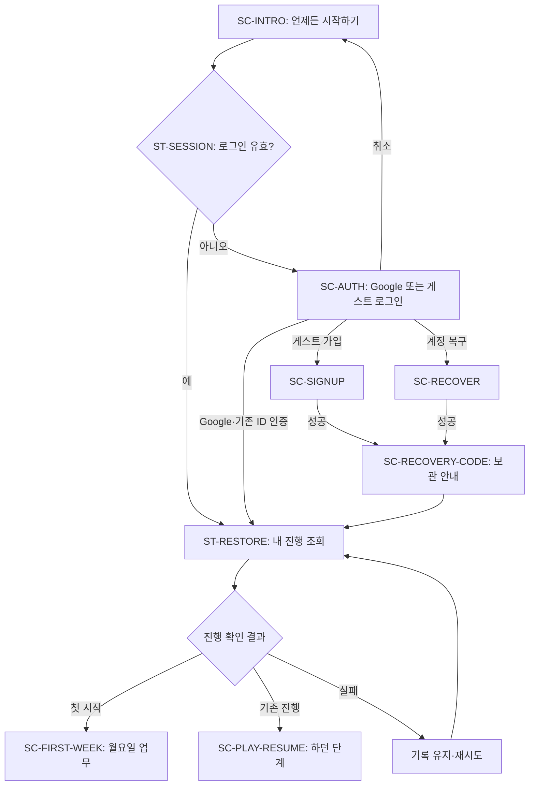

# 화면 흐름 — 진입·인증·평일 업무·장보기

- 상태: 초안 v0.15 — 접속 분기·인증 선택 배치·첫 업무 진입은 확정, 세부 화면 구성은 AI 제안
- 담당: AI 작성, 사용자 검토
- 변경일: 2026-11-27
- 범위: 인트로·로그인·가입·복구·진행 복원·첫 주 진입, 평일 업무의 결과 표시·장보기 구매 흐름
- 관련: [전체 유저 플로우](user-flow.md), [계정 규칙](../03-systems/authentication.md), [입력](../02-gameplay/controls.md), [에셋](../06-art-audio/asset-list.md)

## 확정 사항과 이번 초안

인트로는 공통 시작 화면이며 언제든 `시작하기`를 누를 수 있다. 로그인 상태가 유효하면 저장 진행을 불러오고, 인증이 필요할 때만 로그인·가입을 거친다. 인증 후 신규 계정의 진행이면 첫 주로, 기존 진행이면 하던 단계로 간다(D045~D051).

Google 로그인·게스트 ID/비밀번호·복구 코드·Google 연결 후 기존 진행 유지 정책은 기존 [계정 규칙](../03-systems/authentication.md)을 따른다. SC-AUTH의 Google 주요 버튼과 바로 아래 게스트 로그인·가입 배치(D052), 인증 후 신규 진행의 월요일 직행과 업무 안의 짧은 조작 안내(D053)는 확정했다. 그 밖의 화면 통합·안내 문구·세부 배치·뒤로 가기는 AI의 UX 제안이며 이번 결정은 기획 반영이다.

`SC-`는 논리적 화면 ID다. 웹 페이지·Godot 씬 수를 정하는 것이 아니며, 로그인·가입·복구를 같은 패널의 모드로 구현해도 된다. `ST-`는 처리 상태로서 별도 화면을 강제하지 않는다. 평일 결과·알바 선택은 아래 추가 제안에서 정리하고, 나머지 한 주 화면은 후속 상세화한다.

## 화면 구성안

| ID | 목적·표시 정보 | 주요 행동 | 보조 행동·복귀 |
|---|---|---|---|
| SC-INTRO | 캠핑장·캐릭터·가벼운 이동 안내·시작 버튼 | `시작하기` → ST-SESSION | 이동 체험은 선택. 이동 거리·시간 조건 없음 |
| SC-AUTH | Google 공식 주요 버튼, 바로 아래 게스트 ID·비밀번호 로그인·가입 영역 | Google 인증 또는 `로그인` | `게스트 계정 만들기`, `계정 복구`, 닫기 → 인트로 |
| SC-SIGNUP | 게스트 ID·비밀번호와 입력 조건 | `계정 만들기` → 성공 시 SC-RECOVERY-CODE | 기존 계정 로그인으로 전환, 취소 → SC-AUTH |
| SC-RECOVERY-CODE | 가입/복구로 발급된 코드·보관 안내·분실 시 제약 | `보관 후 계속` → ST-RESTORE | 화면 내 복사·선택 등 보관 지원을 제안. 보관 여부를 퀴즈로 확인하지 않음 |
| SC-RECOVER | 기존 ID·복구 코드·새 비밀번호 | `복구하기` → 성공 시 새 코드 안내 | 취소 → SC-AUTH. 잘못된 코드로 새 계정을 만들지 않음 |
| SC-FIRST-WEEK | 첫 주 월요일의 현재 목표·업무 안의 짧은 조작 안내 | 같은 업무 화면에서 첫 행동 진행 | 인증 후 별도 로비 없이 진입하는 방향 확정(D053). 안내 표시·다시 보기·종료 방식은 미정 |
| SC-PLAY-RESUME | 계정의 저장된 주차·단계·주요 행동 | 저장된 구간의 플레이 | 인트로 체험·신규 안내 반복 없이 이어가기 |

**확정된 로그인 배치(D052):** SC-AUTH에 Google 로그인을 주요 버튼으로 두고 바로 아래에 게스트 로그인·가입을 제공한다. 두 방법 모두 같은 화면에서 찾을 수 있으며 로그인 방법을 고르는 전용 화면을 한 단계 더 요구하지 않는다. 주요 버튼 표시는 Google 인증을 강제하거나 화면 진입 즉시 인증 창을 여는 의미가 아니다.

게스트 가입·복구를 기존 로그인 입력과 구분하고 안내를 짧게 표시하는 방향을 제안한다. 정확한 폼 모양·간격·포커스·입력 오류 표시는 후속 화면 설계에서 정한다.

게스트는 로그인 없는 익명 플레이가 아니라 사용자가 만든 ID·비밀번호 계정임을 명확히 쓴다. Google로 처음 로그인한 사용자에게 별도 게스트 가입·복구 코드 설정을 필수로 추가하지 않는다. 기존 게스트 진행에 Google를 연결하는 일은 게임 내 계정 관리 흐름으로 구분한다.

## 처리 상태와 전환

| ID | 진입 | 정상 전환 | 실패·취소 |
|---|---|---|---|
| ST-SESSION | SC-INTRO에서 시작 선택 | 유효 세션 → ST-RESTORE, 없음/만료 → SC-AUTH | 연결 오류 → 같은 맥락에서 재시도·인트로 복귀. 오류를 신규 계정으로 해석하지 않음 |
| ST-AUTHENTICATING | 로그인·가입·복구 제출 또는 Google 인증 | 해당 계정 인증, 필요한 코드 안내 또는 ST-RESTORE | 잘못된 입력은 필드 가까이 안내. Google 취소는 SC-AUTH로 복귀. 중복 제출 방지 |
| ST-RESTORE | 유효 세션·로그인·가입·복구 완료 | 처음 시작하는 진행 → SC-FIRST-WEEK, 기존 진행 → SC-PLAY-RESUME | 재조회·돌아가기 제공. 조회 실패 시 빈 진행을 생성하거나 덮어쓰지 않음 |

진행을 서버에서 확인하는 상태와 파일 다운로드 상태를 구분한다. 기존 캠핑 배경·패널을 유지한 작은 처리 표시를 우선 제안하며, 짧은 요청마다 전체 화면 로딩을 반복하지 않는다. 실제 자원 준비가 필요할 때만 게임 로딩 안내를 표시한다.

## 대표 경로

## 입력·오류·복귀 UX 제안

- 웹·Android에서 같은 화면 목적·행동 이름·전환 순서를 사용하고 화면 크기에 맞춰 배치한다. 터치·클릭으로 누르거나 키보드·패드로 포커스를 옮겨 같은 행동에 접근한다.
- 로그인 패널을 열면 뒤의 이동 체험 입력을 막고, 닫기·확인 입력이 뒤의 캐릭터 이동으로 중복 전달되지 않도록 한다.
- 소프트 키보드가 현재 입력칸·오류·제출 버튼을 가리지 않게 한다. 폴드 접기·펼치기에서도 작성 중 ID·패널 맥락·제출 상태를 보존하는 방향을 제안한다.
- 로그인과 가입의 버튼 이름을 구분한다. ID가 있다고 자동으로 다른 계정에 로그인시키거나, 인증 실패를 신규 가입으로 전환하지 않는다.
- 같은 양식에서 오류를 고칠 때 불필요한 전체 초기화를 줄인다. 인증 방식·계정을 바꿀 때의 비밀번호·복구 코드 삭제 시점은 별도 정의한다.
- 복구 코드를 보관할 수 있는 수단을 제공하되 자동 다운로드나 별도 개인정보 입력을 강제하지 않는다. 현재 구현의 코드는 한 번 표시하며, 재표시·재발급은 별도 정책 없이 약속하지 않는다.
- 게임 진입 전에 추가 닉네임·캐릭터 생성·설정·Google 연결을 필수 단계로 끼우지 않는다. 이런 기능의 도입은 아직 결정하지 않았다.
- 계정을 바꿔 새 진행을 보는 경우 현재 계정을 알아볼 수 있게 표시한다. 이를 기존 저장이 사라진 것으로 오해하지 않도록 한다.

## 검토할 세부 사항

1. 확정된 Google 주요 버튼·하단 게스트 영역의 반응형 배치, 포커스·오류·안내 상태.
2. 가입·복구 양식의 입력 필드·오류 문구·보관 지원 방식. 현재 구현 수치와 최종 제품 규칙을 구분한다.
3. 인트로↔인증 전환 시 체험 위치·포커스 보존과 요청 취소 처리.
4. 계정에 처음 생성된 진행과 이미 시작한 첫 주를 구별하는 기준. 단순 DB 행 존재 여부만으로 판정하지 않는다.
5. 신규 안내는 월요일 업무 안에서 짧게 제공하는 것으로 확정. 문구·표시·종료/다시 보기·저장 경계와 실제 업무 조작은 후속 정의.

이번 문서는 화면 연결 초안이며 실제 사용성 검증·Android 네이티브 구현 완료를 뜻하지 않는다. 단계가 늘거나 필수 입력이 추가되면 사용자 부담과 필요성을 검토한 뒤 결정 기록에 남긴다.

## 평일 업무 결과 표시 제안

**확정(D054~D055):** 알바는 업무 후에 선택한다. 업무 화면의 작은 결과 카드에 급여·스탯 소모를 표시하고, 알바 선택 때만 시간 제한 없이 대기한다. 미참여 또는 알바 결과 표시 후에는 별도 결과 확인·다음 날 버튼 없이 자동 진행한다. 금요일 장보기 자동 전환도 확정했다(D057). 세부 연출·오류·복구 처리는 제안/미정으로 구분한다. 기획 확정이며 구현 완료는 아니다.

### 같은 화면의 작은 결과 카드

마지막 업무가 끝나면 업무 공간과 HUD를 유지하고 작은 카드에 `오늘 업무 완료`와 **받은 급여·실제로 소모된 스탯**만 표시한다. 소지금·스탯의 숫자 변화는 실제 확정된 결과와 맞춰 한 번 반영한다. 고정 수치·새 보상·성적 등급은 추가하지 않는다.

- 일반적인 결과 표시는 약 1~2초를 초기 표시 목표로 둔다. 정확한 길이는 가독성과 반복 피로도를 시험해 정한다. 별도의 `결과 확인`·`다음 날` 버튼은 두지 않는다.
- 알바를 선택할 수 있는 경우, **같은 카드 아래에 `알바하기 / 오늘은 쉬기`**를 제공하고 선택할 때만 진행을 잠시 멈춘다(D055). 카운트다운·자동 거절은 넣지 않아 선택을 서두르게 하지 않는다.
- `오늘은 쉬기`를 고르면 추가 확인 없이 다음 날로 자동 이동한다. 이 선택 자체에 회복 보상을 임의로 부여하지 않는다.
- 알바를 하면 미니게임으로 연결하고, 끝났을 때 같은 형식으로 추가 수입·소모·오늘 합계를 짧게 보여준 뒤 자동 이동한다. 업무 결과를 여러 페이지로 다시 확인시키지 않는다.
- 월~금 매일 업무 후 같은 카드에서 알바 여부를 선택한다. 하루 최대 1회이며 같은 날 반복 참여 경로는 두지 않는다(D056). 기본급만으로 기본 캠핑이 가능하므로 참여가 필수처럼 보이지 않게 안내한다. 실패·중단 후 재참여 허용 여부는 미정이다.
- 금요일에는 알바를 하지 않기로 선택하거나 알바 결과 표시가 끝나면 장보기로 자동 전환한다(D057). 장보기로 가기 위한 별도 확인·이동 버튼을 두지 않는다.

| 표시·상태 ID | 표현 | 종료·복귀 |
|---|---|---|
| ST-WORK-RESULT | 업무 화면의 결과 카드·HUD 변화 | SC-JOB-CHOICE로 연결해 하루 1회 참여 여부 선택 |
| SC-JOB-CHOICE | 같은 결과 카드의 알바 참여·미참여 선택 | 참여 시 알바, 미참여 시 자동 전환. 선택 중에만 시간 제한 없이 대기(D055) |
| ST-JOB-RESULT | 알바 결과·오늘 합계의 짧은 표시 | 자동 전환 |
| ST-DAY-TRANSITION | 짧은 날짜 전환·다음 날 목표 | 월~목은 다음 날 업무, 금요일은 장보기로 자동 전환(D057) |

화면을 크게 덮는 결과 창·새 로비·매일 필수 확인 버튼을 추가하지 않는 방향이다. 터치·클릭·키보드·패드에서 같은 선택에 접근하고 결과 카드는 풍경과 현재 목표를 가리지 않게 배치한다.

자동 이동은 확정 결과를 확인한 뒤 진행하는 방향을 제안한다. 저장 결과가 불명확하거나 오류가 있으면 자동 진행으로 숨기지 않고 조회·재시도 경로를 제공한다. 알바 중단·진행 도중 앱 종료·결과 표시 중 재접속의 복원 범위는 후속 정의한다.

## 장보기 흐름

**확정(D058):** 메뉴를 선택하고 필요한 재료·총금액을 확인한 뒤 한 번에 구매한다. 저녁은 기존 라면·꼬치구이 두 계열에서 시작하고 아침 커피·토스트에 필요한 재료도 장보기 범위에 포함한다. 실제 재료·수량·가격·레시피 수는 기존 기획의 미정 범위를 유지한다.

| 화면·처리 ID | 목적·표시 | 주요 행동·다음 상태 |
|---|---|---|
| SC-SHOP-MENU | 저녁 메뉴와 아침 준비를 알아보기 쉽게 선택 | 선택에 맞는 SC-SHOP-REVIEW로 연결 |
| SC-SHOP-REVIEW | 선택 메뉴·필요한 재료·총금액·보유금액 확인 | `구매하기`로 ST-PURCHASING, 구매 전 메뉴 수정 |
| ST-PURCHASING | 선택한 재료의 일괄 구매 처리 상태 | 구매 성공 → ST-PURCHASE-DONE. 실패·결과 불명확 시 구매 확인·재시도 경로를 유지하는 안 |
| ST-PURCHASE-DONE | 짧은 구매 완료 표시 | 별도 확인·이동 버튼 없이 짐 싸기로 자동 전환(D059). 정확한 표시 길이는 미정 |

위 ID는 한 화면의 선택·요약 영역으로 구성해도 된다. 세 개의 별도 페이지나 추가 확인창을 강제하지 않는다. 사용자가 총액을 확인한 뒤 구매 버튼을 누르는 한 번의 확정 행동으로 묶는 방향이다.

**AI의 상세 UX 제안:**

- 메뉴를 고르면 필요한 재료 목록과 총액을 가까이 보여준다. 아이템을 하나씩 찾지 않아도 구매 내용을 알 수 있게 한다. 개별 재료 변경·추가·수량 조절 범위는 미정이다.
- 보유 금액과 구매 후 남을 금액을 함께 표시하는 안을 제안한다. 최종 보상·가격 값은 이 화면 설계로 결정하지 않는다.
- 구매 전 메뉴 변경에는 결제·재료 소비를 일으키지 않는다. 선택을 바꾸면 목록·총액을 갱신하고 수정한 결과를 확인할 수 있게 한다.
- 필수 재료·소지금 부족은 구매 전에 설명하고 고칠 수 있는 곳을 안내한다. 부족액 자동 지급·강제 알바·마이너스 잔액은 채택하지 않았다. 기본급으로 기본 캠핑이 가능하다는 D056의 비용 설계를 따른다.
- 구매 처리 중 중복 입력을 막고, 응답이 불명확하면 실제 구매 결과부터 조회하는 방향을 제안한다. 재시도로 돈·재료가 두 번 처리되지 않도록 한다.

구매 완료를 짧게 보여준 뒤 짐 싸기로 자동 전환하는 흐름은 확정했다(D059). 구매 후 메뉴 변경·교환·환불과 장보기 재진입·추가 구매는 아직 미정이다. 해당 규칙 없이 짐 싸기에서 구매를 되돌리거나 이미 확정된 재료를 다른 메뉴로 교체하지 않는다.

## 짐 싸기와 출발

**확정(D060):** 준비가 끝나도 자동 출발하지 않는다. 장비를 골라 트렁크에 배치한 뒤 사용자가 `출발하기`를 눌러 캠핑으로 넘어간다.

| 화면·처리 ID | 표시 정보 | 주요 행동·다음 상태 |
|---|---|---|
| SC-PACK | 장비 선택·트렁크 배치·준비 상태 | 준비를 검토한 뒤 `출발하기` 선택 |
| ST-DEPART | 출발 요청·필요한 준비 상태 확인 | 캠핑장 설치 단계로 연결. 이동 연출·저장·실패 복구는 미정 |

**AI의 상세 UX 제안:** 장비 선택과 적재 상태를 한 맥락에서 보여주고, 준비가 되면 이를 알리되 사용자가 정리·배치를 더 검토할 시간을 준다. 출발할 수 없는 조건이 있다면 이유와 수정할 위치를 같은 화면에서 안내한다. `출발하기` 뒤 추가 확인창을 매번 띄울지는 아직 정하지 않았으며 이번 결정으로 추가하지 않는다.

필수 장비 목록·트렁크 용량·겹침/회전·준비 완료 판정·출발 전 수정 범위는 미정이다. 현재 프로토타입의 장비 3종 선택·무료 고급 장비 대여를 이 화면의 최종 규칙으로 가져오지 않는다. 출발 확인 자체와 이미 완료된 장보기의 변경·환불 정책도 구분한다.

## 캠핑장 설치와 자유 휴식

**확정(D061):** 설치를 마치면 별도 완료 화면 없이 같은 캠핑장에서 자유 휴식으로 이어진다. 사용자는 풍경을 보거나 움직이며 쉬고, 원할 때 저녁 준비로 넘어간다. 기획된 휴식의 사용자 주도 종료 규칙을 유지한다.

| 화면·상태 ID | 목적·표시 | 전환 |
|---|---|---|
| SC-CAMPSITE | 같은 캠핑장 안에서 설치 대상·배치 상태 표시 | 설치 완료 후 같은 화면의 ST-FREE-REST로 연결 |
| ST-FREE-REST | 캠핑 풍경·자유 이동, 저녁으로 가는 행동 | 사용자가 선택하면 저녁 준비. 자동 종료·필수 대기 없음 |

**세부 UX 제안:** 설치 중의 조작 패널·완료 안내를 정리하고 풍경이 잘 보이도록 현재 행동 UI를 바꾼다. 같은 장소를 다시 불러오거나 설치 결과 확인 버튼을 누르게 하지 않는다. 완료를 알리는 작은 문구가 필요할지는 후속 검토한다. 자동 전환은 설치 단계가 끝났다는 뜻이며 이동 중인 캐릭터를 임의로 이동시키는 결정은 아니다.

설치 완료를 판정할 필수 장비·방향·배치 조건, 자유 휴식의 추가 행동과 보상·반복 규칙은 아직 미정이다. 휴식에 들어갔다고 설치 수정·장비 재배치가 가능한지까지 확정한 것은 아니다.

## 저녁 조리 확대 화면

**확정(D062):** 캠핑장 위에 조리 확대 화면을 열어 요리를 조작하고, 요리가 완성되면 확대 화면을 닫아 같은 캠핑장으로 돌아온다. 조리 장소를 별도 공간으로 바꾸거나 캠핑장부터 다시 입장하는 흐름을 만들지 않는다.

| 화면·상태 ID | 표시·행동 | 전환 |
|---|---|---|
| SC-COOKING | 캠핑장을 배경으로 선택 메뉴·장비·재료·조리 대상을 확대 표시 | 기획된 요리 조작. 완성 시 ST-COOKING-DONE |
| ST-COOKING-DONE | 조리 완료 상태 | 확대 화면을 닫고 기존 SC-CAMPSITE의 ST-MEAL-READY로 복귀 |
| ST-MEAL-READY | 캠핑장에서 완성 요리와 `먹기` 표시 | 자동 섭취하지 않고 사용자 선택을 기다림(D063) |
| ST-EATING | 사용자가 `먹기`를 선택해 식사 시작 | 섭취 효과에 연결하고 ST-MEAL-RESULT로 이동 |
| ST-MEAL-RESULT | 회복량·레시피 변화를 짧게 요약 | 별도 결과 확인 버튼 없이 같은 캠핑장의 ST-NIGHT-REST로 자동 연결(D064) |
| ST-NIGHT-REST | 불멍·별구경·취침 선택 | 사용자가 원할 때 취침. 자동 종료·강제 대기 없음 |

**세부 UX 제안:** 조리 입력은 확대 화면에서 처리하고 같은 입력이 뒤의 캐릭터 이동으로 전달되지 않게 한다. 첫 조리 안내는 해당 화면에서 짧게 제공한다. 폰·웹·펼친 폴드에 같은 행동을 제공하되 확대 영역과 필수 UI는 크기에 맞춰 배치한다. 배경과 캐릭터를 완전히 가릴지, 얼마만큼 남길지는 아직 미정이다.

라면과 꼬치의 실제 조작·판정·기본 키/버튼은 후속 정의하며, 꼬치 재료를 직접 꽂고 굽는 기획은 유지한다. 뒤로 가기로 조리를 중단할 때 재료·진행을 어떻게 처리할지, 완성 뒤에는 캠핑장에서 사용자가 `먹기`를 선택해 식사를 시작하는 것으로 확정했다(D063). 회복량·레시피 변화를 짧게 보여준 뒤 같은 캠핑장의 밤 휴식으로 자동 연결하는 것은 확정했다(D064). 식사 연출·정확한 표시 시간·효과 반영 시점은 후속 정의한다. 화면을 닫는 것만으로 음식을 먹었거나 스탯이 회복됐다고 처리하지 않는다. 레시피 조리 기록과 섭취 효과를 구분하고 D025~D027의 규칙을 유지한다.

### 식사 결과와 밤 휴식 연결

**확정(D064):** 식사 후 회복량과 레시피 변화를 짧게 보여주고 같은 캠핑장에서 불멍·별구경으로 자동 연결한다. 사용자가 결과 확인 버튼을 누를 때까지 기다리는 별도 화면은 두지 않는다. 밤 휴식에 들어간 뒤에는 사용자가 원할 때 취침을 선택한다.

결과는 실제 스탯 변화와 이번 조리에서 바뀐 레시피 기록을 요약하는 것이다. 조리 시 이미 반영한 별점·숙련을 식사 결과 표시 때문에 다시 지급하거나 갱신하지 않는다. 기록의 상세 화면·배지·표현은 후속 설계한다. 밤으로의 페이드·조명 변화·정확한 표시 길이는 미정이며, 같은 캠핑장을 유지하는 조건을 따른다.

## 아침 커피·토스트 준비

**확정(D065):** 일요일 아침도 저녁과 같은 조리 확대 화면 방식을 사용해 커피와 토스트를 직접 준비한다. 익힌 화면 구조·공통 조작 체계를 재사용하고, 커피·토스트에 필요한 실제 조작을 따로 구체화한다.

| 화면·상태 ID | 목적 | 다음 상태 |
|---|---|---|
| SC-BREAKFAST-COOKING | 캠핑장을 배경으로 커피·토스트 준비 대상을 확대 표시 | 기획된 준비·조리로 ST-BREAKFAST-READY |
| ST-BREAKFAST-READY | 커피·토스트 완성 상태 | 캠핑장 복귀·식사·철수 연결 방식은 후속 정의 |

커피와 토스트를 만드는 순서·단계 수·동시 진행 여부·각 입력·판정은 아직 미정이다. 처음부터 드립커피·원두·그릴/오픈 토스트까지 모두 구현하는 결정이 아니며 기존 확장 시점을 유지한다. 준비가 끝나도 자동 섭취인지 사용자 선택인지, 식사 후 바로 철수하는지 여유를 두는지는 아직 확정하지 않았다.

**세부 UX 제안:** 저녁에서 익힌 확대·확인·닫기 원칙과 폰·폴드·웹 공통 UI를 유지한다. 차이가 있는 조작만 짧게 안내하고 이미 아는 설명을 전부 다시 요구하지 않는다. 기존 프로토타입의 커피·토스트 한 버튼 처리를 최종 직접 조작 방식으로 고정하지 않는다.
