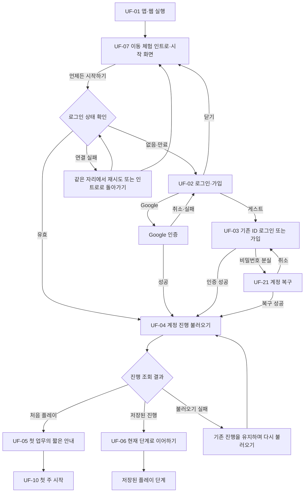
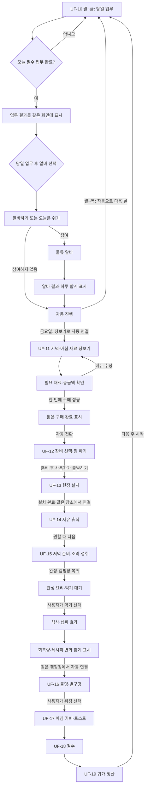
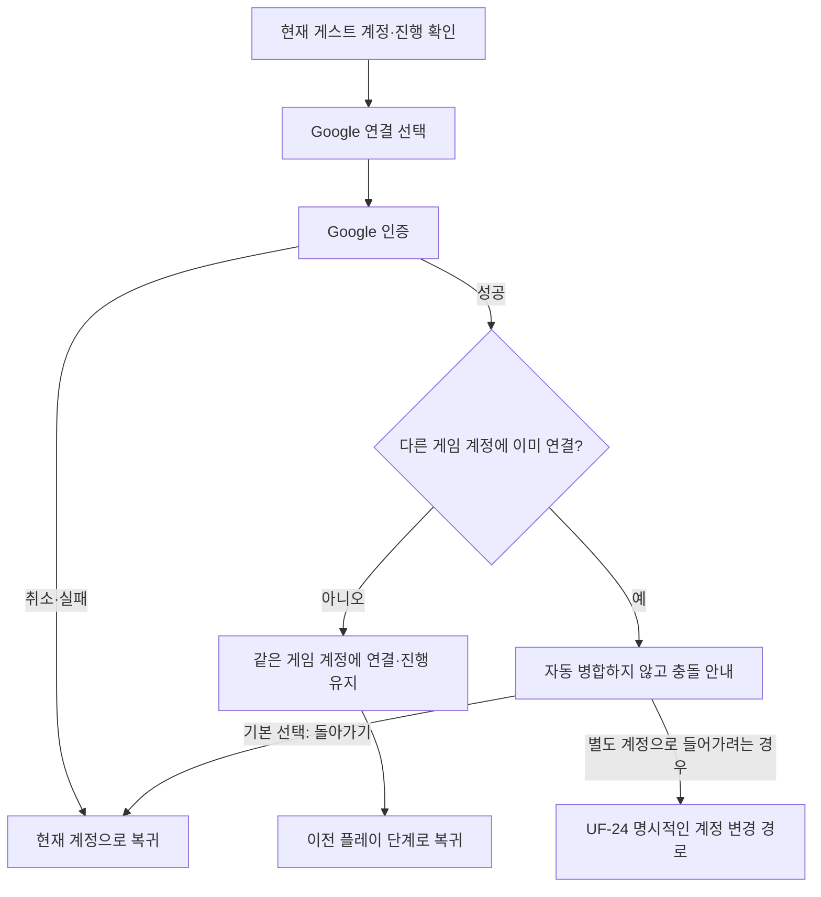

# 전체 유저 플로우

- 상태: 초안 v0.23 — 기존 확정 기획을 연결한 UX 제안, 승인·구현 완료 문서가 아님
- 담당: AI 작성, 사용자 검토
- 변경일: 2026-11-27
- 목적: 처음 온 사용자도 다음 행동을 이해하고, 다시 온 사용자는 하던 플레이에 편하게 복귀한다.
- 관련: [세션 흐름](../02-gameplay/session-flow.md), [계정](../03-systems/authentication.md), [시스템](../03-systems/README.md), [에셋 목록](../06-art-audio/asset-list.md), [화면 대응](../07-technical/android.md)

## 범위와 근거

핵심 반복의 목적은 돈을 벌어 아이템을 구매하고 크고 화려한 캠핑장을 꾸미는 것이다(D066). 아래 주간 순서는 기존 결정이며, 캠핑장 배치의 주간 유지 여부와 설치·철수의 관계는 재검토가 필요하다. 아이템 구매를 기존 식재료 장보기와 같은 화면·시점에 넣는지는 미정이다.

앱·웹 실행 → 인증·복원 → 한 주 플레이 → 정산·다음 주 → 중단·재접속, 그리고 계정 연결·복구의 전체 여정을 정의한다. 아래 ID는 사용자 목적과 상태를 구분하는 **플로우 ID**다. 각각을 별도 화면·씬으로 만들라는 뜻은 아니다. 실제 화면 ID·레이아웃·전환 연출은 후속 `screen-flow.md`·HUD 명세로 구체화한다.

| 구분 | 내용 | 근거 |
|---|---|---|
| 확정 기획 | Android·웹 공통 계정, Google 로그인·게스트 ID/비밀번호·복구 코드, 게스트의 Google 연결 후 진행과 기존 로그인 유지 | [계정](../03-systems/authentication.md), D010~D017 |
| 확정 기획 | 평일 업무 → 장보기 → 짐 싸기 → 설치 → 자유 휴식 → 저녁 → 밤·취침 → 아침 → 철수 → 정산·다음 주 | [세션 흐름](../02-gameplay/session-flow.md), D032 |
| 확정 기획 | 업무 완료 전 다음 날로 이동하지 않음, 알바는 선택, 휴식은 사용자의 다음 선택으로 종료, 약 15분은 테스트 목표 | [세션 흐름](../02-gameplay/session-flow.md), D032~D033 |
| 확정 기획 | 라면·꼬치구이, 커피·토스트, 장비에 따른 조리·휴식 효과, 레시피 별점·숙련도 | [시스템](../03-systems/README.md), D023~D031 |
| 확정 UX 방향 | 편한 사용자 흐름을 최우선으로 초안 작성. 사이드바를 분해하고 폰·폴드·웹에 대응 | 이번 사용자 요청, D035·D043 |
| 확정 진입 방향 | 첫 방문에 로그인 전 가벼운 캐릭터 이동 체험으로 캠핑 인트로를 경험한 뒤 인증·첫 주 시작 | 사용자 선택, D045~D047 |
| 확정 입력 요구 | 터치·클릭은 목적지 이동, 키보드·패드는 직접 이동. 웹·Android의 인터페이스는 공통 | 사용자 선택, D048~D049·[조작](../02-gameplay/controls.md) |
| 확정 인트로 종료 | `시작하기`는 진입부터 사용 가능. 이동 여부·거리·시간과 관계없이 로그인·가입으로 이동 | 사용자 동의, D050 |
| 확정 접속 분기 | 인트로의 시작 버튼 뒤 로그인 유효 시 이어하기, 필요 시 인증, 신규 진행이면 첫 주 시작 | 사용자 확인, D051 |
| 확정 인증 화면 | Google 주요 버튼과 바로 아래 게스트 로그인·가입을 같은 화면에서 제공 | 사용자 동의, D052·[화면 흐름](screen-flow.md) |
| 확정 플레이 진입 | 신규 진행은 인증 후 별도 로비 없이 월요일 업무로 진입하고 그 안에서 짧게 조작 안내. 기존 진행은 저장 단계로 복귀 | 사용자 동의, D053 |
| 확정 평일 흐름 | 알바는 당일 업무 후 선택, 다음 날 이동은 자동 진행 | 사용자 결정, D054~D055. 작은 결과 카드·알바 선택 시 시간 제한 없는 대기·나머지 자동 진행 |
| AI 제안 | 복귀 맥락 안내, 이후 행동 시점별 안내, 선택 보존, 부담이 적은 결과 표시·전환 방식 | 이 초안에서 검토할 사항 |
| 미정 | 최종 MVP·시점·방향, 구간별 직접 조작, 실패·재료 부족·오프라인 정책, 세부 저장 시점 | [범위](../01-vision/scope.md), 기존 시스템·기술 문서 |

현재 버튼 프로토타입의 조작 횟수·가격·최소 장비·무료 대여·스탯 수치는 최종 규칙으로 가져오지 않는다. 기획 문서의 메뉴·미니게임 예시 역시 자동 확정하지 않는다.

## UX 원칙 — 적용 제안

1. **복귀를 짧게 한다.** 인트로에서 `시작하기`를 누른 뒤 유효 세션과 저장 진행이 있으면 로그인 선택·필수 로비·반복 안내 없이 하던 구간으로 복귀한다. 잠시 주차·요일·현재 할 일을 보여 맥락을 회복시킨다.
2. **다음 행동 하나를 눈에 띄게 한다.** 현재 목표와 주요 행동을 짧게 표시한다. 선택 알바·레시피 기록·계정 관리는 구분하고, 지금 못 하는 행동에는 이유와 해결 방법을 가까이 둔다.
3. **필요할 때 알려준다.** 긴 시작 설명이나 외워야 할 조작표 대신 첫 업무·첫 설치·첫 요리에서 해당 조작을 안내한다. 이미 본 설명은 반복하지 않고 필요한 경우 다시 볼 수 있게 하는 방향을 제안한다.
4. **사용자의 여유와 선택을 보존한다.** 알바나 추가 휴식을 강제하지 않는다. 휴식은 자동 종료하지 않고, 준비 중 이전 단계로 돌아와도 가능한 선택은 유지한다. 이미 확정된 지출·결과를 취소하는 것은 별도 규칙이 필요하다.
5. **작은 행동마다 화면을 갈아 끼우지 않는다.** 세계·HUD를 유지하고 필요한 패널이나 조리 확대 화면만 열고 닫는 방식을 우선 제안한다. 장비 하나 놓을 때마다 로딩하거나 결과 확인 창을 띄우지 않는다.
6. **확인은 손실·확정에 집중한다.** 되돌릴 수 있는 선택은 바로 변경하고, 구매 확정·계정 변경 등 결과가 달라지는 행동은 결과를 분명히 알린다. 모든 클릭에 확인 창을 붙이지 않는다.
7. **오류 후의 다음 길을 제공한다.** 오류 설명만 남기지 않고 재시도·입력 수정·돌아가기 등 가능한 행동을 제공한다. 무엇이 저장되었는지 모르는 상태에서 구매·보상·조리를 중복 실행하지 않는다.
8. **화면 크기가 바뀌어도 같은 여정이다.** 폰·폴드·웹에 같은 용어·주요 행동을 사용한다. 패널 위치만 재배치하고 접기·펼치기 때문에 단계나 선택을 초기화하지 않는다.

## 1. 실행·인증·복귀

다이어그램의 시작 버튼 뒤 접속 분기는 D051로 확정했고, 복귀 맥락 안내 등 세부 표현은 AI 제안이다. 연결 실패를 세션 만료로 간주하거나, 불러오기 실패를 신규 사용자로 판단해 새 진행을 만드는 경로는 두지 않는다.

| ID | 사용자 목적과 주요 행동 | 정상 결과 | 취소·실패·UX 처리 |
|---|---|---|---|
| UF-01 | 실행하고 준비 상태를 이해한다 | 인증 확인과 필요한 자원 준비 | 최초 수신·추가 준비 상태를 구분. 가짜 진행률·인위적인 대기 없이 안내하고 실행 실패 시 재시도 제공 |
| UF-02 | Google 또는 게스트 방식으로 시작한다 | 선택한 인증 경로로 이동 | Google 주요 버튼과 바로 아래 게스트 로그인·가입을 한 화면에 표시(D052). Google 연결을 필수로 안내하거나 게스트를 계정 없는 일회용 플레이로 표현하지 않음 |
| UF-03 | 기존 게스트로 로그인하거나 새 ID·비밀번호를 만든다 | 계정 확인, 신규 가입이면 복구 코드 안내 | 로그인과 가입 구분. 같은 화면에서 입력 오류·중복 ID를 설명하고 재입력 최소화. 비밀번호·복구 코드를 로그나 URL에 노출하지 않음 |
| UF-04 | 내 계정의 진행을 불러온다 | 신규/기존 진행에 따라 분기 | 계정명·방식을 알아볼 수 있게 함. 다른 계정의 빈 진행을 기존 진행이 사라진 것으로 오해하지 않게 안내. 조회 실패 시 기존 기록 덮어쓰기 금지 |
| UF-05 | 인증 후 첫 행동을 익힌다 | 별도 로비 없이 첫 주 월요일 업무로 진입 | 업무 화면 안의 짧은 조작 안내는 확정(D053). 안내 문구·표시·종료/다시 보기 방식은 미정. 캐릭터 생성·설정 단계를 새 필수 절차로 추가하지 않음 |
| UF-06 | 하던 곳을 기억하고 이어 한다 | 저장된 주차·단계·확정 상태로 복귀 | 짧은 현재 목표 표시. 첫 캠핑 체험·첫 안내·새 계정 생성을 반복하는 것을 기본 경로로 삼지 않음 |
| UF-07 | 계정을 만들기 전에 캐릭터를 가볍게 움직이며 캠핑 분위기를 느낀다 | 이동 체험 인트로 → 시작하기 → 로그인 상태별 접속 분기 | 로그인 전 이동 체험과 진입부터 사용 가능한 `시작하기`는 확정. 이동량·체류 시간 조건 없이 접속 분기로 이동. 구체 키/버튼·이동 범위·기존 계정 바로가기는 후속 정의 |

첫 게스트 가입의 복구 코드는 한 번의 안내에 모아 보여주고 보관 방법과 분실 시 제약을 알리는 방향을 제안한다. 별도 퀴즈나 보관 증명은 요구하지 않는다. 코드 재발급·다시 보기 방식은 [계정 명세](../03-systems/authentication.md)와 맞춰 결정해야 하며, 현재 구현에 없는 재표시 기능을 약속하지 않는다.

### 첫 캠핑 분위기 체험 — 방향 확정·세부 구성 제안

사용자는 첫 방문에 짧게 캠핑 분위기를 경험한 뒤 첫 주를 시작하고(D045), 이를 로그인 전에 보여주는 인트로로 배치하기로 했다(D046). 이 인트로는 풍경 관람만 하는 형태가 아닌 가벼운 캐릭터 이동 체험으로 한다(D047). 기존의 월~금 → 캠핑 한 주를 시작하기 전에 도입부를 추가한다. 실제 첫 주에서 평일 업무를 생략하거나 첫 캠핑을 이미 완료한 것으로 처리하지 않는다.

**확정된 종료 방식(D050):** `시작하기`를 인트로 진입부터 표시하고 사용할 수 있게 한다. 캐릭터를 움직이지 않거나 오래 머물지 않아도 버튼으로 접속할 수 있다. 로그인 상태가 유효하면 이어하기, 인증이 필요하면 로그인·가입으로 연결한다(D051). 이동 횟수·거리·체류 시간을 채워야 버튼이 열리는 조건을 두지 않는다.

**AI의 UX 제안:**

- 기존 캠핑장·모닥불·귀여운 캐릭터를 재사용한 짧은 장면으로 분위기를 먼저 보여준다. 밤 풍경은 초기 연출안이며 최종 시간대·2D/3D 방식은 미정이다. 새 음원·아이템·보상을 필수로 추가하지 않는다.
- 확정된 `시작하기` 동작에 현재 계정의 이어하기 또는 로그인으로 연결됨을 알리는 짧은 안내를 붙인다. 기존 계정 로그인에도 바로 접근하게 하고 별도 건너뛰기·시작 확인을 연달아 요구하지 않는 안을 제안한다.
**확정된 체험 방식:** 캠핑장에서 캐릭터를 가볍게 움직여본다. 이동 외의 장비 설치·요리·아이템 획득·퀘스트는 아직 채택하지 않았다.

**이동 체험의 세부 UX 제안:**

- 짧게 움직이며 풍경을 느끼는 범위로 구성하고 긴 조작 설명이나 별도 조작 시험을 요구하지 않는다.
- 작은 이동 가능 영역을 사용하고 복잡한 길 찾기나 이동 실패 페널티를 넣지 않는 방향을 제안한다. 실제 영역·카메라 추적 방식은 미정이다.
- 체험으로 소지금·스탯·장비·레시피 기록을 변경하지 않는 안을 제안한다. 인증 전 체험을 본 진행으로 저장·인계하는 기능은 확정하지 않는다.
- 시작 버튼을 누를 때 이동 중이었다면 이동 체험을 끝내고 인증 흐름으로 전환하는 안을 제안한다. 입력 중복·오류 시 전환 처리와 뒤로 돌아왔을 때의 위치 보존은 후속 정의한다.
- **지원 입력은 확정:** 터치·마우스 클릭·키보드·게임패드 모두 지원한다(D048). 터치·클릭은 누른 위치로 이동하고 키보드·패드는 캐릭터를 직접 조작한다(D049). 웹·Android의 UI는 공통으로 두며 구체 키/버튼 매핑·포커스·장치 전환은 [입력과 조작](../02-gameplay/controls.md)에서 후속 정의한다.
- 인트로 이후 인증을 마치고 신규 진행의 첫 주를 시작하면 월요일 업무로 연결하고, 필요한 첫 업무 안내만 짧게 제공한다. 이후 설치·조리 안내는 해당 행동 시점에 제공한다.
- 재방문도 시작 화면에서 즉시 접속해 진행을 복원하며 체험을 반복 강제하지 않는다. 도중 종료 시에는 이미 시작한 첫 주를 초기화하지 않는다. 체험을 본 것으로 처리하는 시점과 표시 여부 저장 방식은 상세 설계한다.

인트로는 이동 체험을 해도 되고 바로 접속해도 되는 **공통 시작 화면**이다(D051). `실행 → 인트로 → 시작하기` 뒤 로그인 상태가 유효하면 저장된 진행으로 이어하고, 인증이 필요하면 로그인·가입으로 연결한다. 인증 후 처음 플레이하는 계정이면 첫 주를 시작한다. 인트로 표시와 체험 수행은 다른 개념이므로 재방문 때 체험을 다시 완료할 조건이 없다. 별도로 인트로 자동 생략 여부를 묻거나 필수 재체험 경로를 두지 않는다.

로그인 전에는 어떤 계정의 첫 방문인지 확실히 알 수 없으므로 공통 인트로에서 누구나 `시작하기`로 바로 접속 분기로 넘어갈 수 있다(D050~D051). 기기 저장 정보는 인증 수단으로 쓰지 않는다. **연출 길이·전환·키/버튼 매핑·이동 범위·재보기·완료 상태 저장**은 미정이다. 지원 입력과 입력별 이동 방식·공통 UI 방향은 D048~D049로 확정했다. 신규 계정도 서버 진행 행이 생성될 수 있으므로 단순히 진행 데이터의 존재로 첫 주 시작 여부를 판정하지 않는다.

인트로는 분위기를 경험하는 콘텐츠이고 로딩은 자원 준비 상태를 알리는 과정이다. 로딩의 완료를 인트로 관람 시간이나 필수 조작과 묶지 않는다. 별도의 강제 로고 영상·필수 튜토리얼을 추가하는 결정은 아니다.

인증 후 신규 진행을 시작할 때 전용 홈·로비를 거치지 않고 월요일 업무에 진입해 그 안에서 짧게 조작을 안내한다(D053). 기존 진행은 저장된 단계로 연결한다. 15분 완주 테스트 목표에서 첫 도입부 시간을 어떻게 측정할지는 별도로 정한다. 현재 구현에는 전용 첫 체험 진입·종료가 아직 없다.

## 2. 한 주의 기본 플레이

알바를 당일 업무 후에 선택하고 평일의 다음 날 진행을 자동으로 하는 방향은 D054로 확정했다. 작은 결과 카드와 알바 선택 때만 시간 제한 없이 멈추고 나머지는 자동 진행하는 흐름은 D055로 확정했다. 금요일에도 알바 미참여 선택 또는 알바 결과 표시 뒤 장보기로 자동 연결한다(D057). 결과 표시의 초기 목표는 약 1~2초이며 실제 길이는 검증해 조정한다.

알바는 월~금 매일 업무 후 선택할 수 있고 하루 최대 1회다(D056). 알바 없이도 기본급으로 기본 캠핑이 가능하며 추가 수입은 재료·장비 선택을 넓힌다. 세션 표의 한 주 알바 1회·15분은 시험 기준 사례이며 최대 5회 참여하면 현재 시간 가정상 약 17분이므로 다시 측정한다. 실패·중단 시 횟수 소모와 보상 처리는 미정이다.

장보기는 **메뉴 선택 → 필요한 재료·총금액 확인 → 한 번에 구매**로 확정했다(D058). 성공하면 구매 완료를 짧게 보여준 뒤 짐 싸기로 자동 전환한다(D059). 메뉴 수정은 구매 전 장보기 안에서 수행하는 UX를 제안한다. 이전 초안의 짐 싸기에서 구매 전 장보기로 돌아가는 선은 이 흐름에 맞춰 제거했다. 구매 후 메뉴 변경·재구매·환불은 아직 미정이며 자동 취소·무료 변경을 약속하지 않는다.

| ID·구간 | 지금 보여줄 것 | 주요 행동과 완료 조건 | UX 초안·되돌아가기 |
|---|---|---|---|
| UF-10 평일 업무 | 요일·남은 당일 업무·주말 목표, 필요 시 소모/보상 | 당일 업무 후 알바 선택 흐름과 연결하고 평일 다음 날은 자동 진행 | 작은 결과 카드와 알바 선택 중 대기, 선택 후 자동 진행은 확정(D055). 업무를 끝내기 전 다음 날로 넘기지 않음. 세 비교안을 전부 연속 통과해야 캠핑 가능한 것으로 만들지 않음 |
| UF-10 선택 알바 | 선택 활동임을 명시, 소모·보상·가능 조건 | 매일 업무 후 선택·하루 최대 1회, 종료 후 자동 진행 | 기본급만으로 기본 캠핑 가능. 알바는 추가 선택을 위한 수입. 실패·중단 시 횟수 소모와 보상은 미정 |
| UF-11 장보기 | 저녁 두 계열·아침 재료, 비용·현재 소지금·구매 결과 | 메뉴 선택 → 필요 재료·총액 확인 → 한 번에 구매(D058) | 구매 전 메뉴를 쉽게 바꾸는 UX를 제안. 레시피·재료 종류와 버튼만으로 묘사할지 직접 고를지는 별도. 재료 부족을 나중에 갑자기 알리기보다 준비 중 확인 |
| UF-12 짐 싸기 | 선택한 재료·장비·준비 상태·부족한 준비 | 준비를 마치고 사용자가 `출발하기` 선택. 자동 출발 없음(D060) | 장비·배치를 검토할 수 있도록 유지. 필수 장비·적재 규칙 미정; 현재 프로토타입의 장비 3개를 최종 목록으로 확정하지 않음 |
| UF-13 설치 | 빈 자리·선택 장비·설치 상태·다음 할 일 | 설치 완료 시 별도 완료 화면 없이 같은 캠핑장의 자유 휴식으로 연결(D061) | 배치 가능한 곳·현재 대상 피드백. 조작 확정 전 방향 조절·그리드·회전 횟수를 고정하지 않음. 작은 배치 수정마다 확인 창을 띄우지 않는 방향 |
| UF-14 자유 휴식 | 캠핑 풍경, 필요하면 활동·상태 변화 | 산책·풍경 감상 후 원할 때 저녁으로 이동 | 풍경을 가리지 않는 최소 UI. 회복을 위해 의무 대기하지 않음. 휴식 지속 시간과 보상 수치는 미정 |
| UF-15 저녁 | 선택 메뉴·장비·재료·현재 조리 단계·기대 효과 | 라면 또는 꼬치구이를 준비·조리·먹기 | 캠핑장 위에 조리 확대 화면을 열고 완성하면 닫아 같은 장소로 복귀(D062). 사용자가 `먹기`를 선택해 식사 시작(D063). 결과 요약 뒤 같은 캠핑장의 밤 휴식으로 자동 연결(D064). 꼬치는 직접 재료를 꽂고 굽는 기획 유지. 첫 조리 조작은 맥락형 안내. 완성·섭취·스탯·기록 변화를 한 맥락에 묶고 여러 결과 창을 연속 강제하지 않는 방향 |
| UF-16 밤·취침 | 불멍·별구경·장비 효과, 취침 행동 | 원하는 만큼 쉬고 사용자가 취침 선택 | 불멍을 타이머로 자동 종료하지 않음. 별똥별·소원 이벤트는 미채택 제안이므로 필수 경로에서 제외 |
| UF-17 아침 | 커피·토스트 준비 상태, 필요한 조작·결과 | 저녁과 같은 조리 확대 UI로 커피·토스트 직접 준비(D065) | 완성 후 식사·철수 연결은 후속 정의. 첫 테스트의 믹스·버터 표현과 확장 콘텐츠를 구분. 현재의 한 버튼 구현을 최종 조리 규칙으로 고정하지 않음 |
| UF-18 철수 | 남은 장비·정리 상태·적재 결과 | 정리·차에 싣기를 마침 | 무엇이 남았는지 화면으로 보이게 함. 같은 동작마다 중간 결과 확인을 요구하지 않음. 철수 생략·일괄 완료는 새 기능이므로 기본안에 넣지 않음 |
| UF-19 정산 | 쓴 재료·회복량·레시피 변화·유지되는 진행 | 결과를 확인하고 다음 주 시작 또는 여기서 중단 | 핵심 결과를 한 곳에 요약. 새 주의 업무를 사용자의 선택 없이 즉시 시작하지 않음. 한 주를 마쳤으니 나가기 좋은 지점으로 제공 |

라면·꼬치 계열, 커피·토스트와 장비별 효과는 기존 기획을 따른다. 더 좋은 장비 구매·해금, 품절·파산·잘못된 조리·실패 재료 손실의 상세 분기는 아직 규칙이 없어 확정 흐름으로 그리지 않았다.

## 3. 플레이 중 열 수 있는 보조 흐름

**제안:** 현재 게임 상태를 유지한 채 작은 패널·오버레이로 열고, 닫으면 같은 단계로 돌아온다. 플랫폼별 구현 방법은 별도이며 현재 웹의 전체 페이지 이동을 목표 UX로 확정하지 않는다.

| ID | 진입·주요 목적 | 복귀와 보호할 것 |
|---|---|---|
| UF-20 계정·Google 연결 | 게스트로 플레이 중 계정 관리에서 현재 계정·Google 연결 상태 확인 | 현재 계정의 진행에 연결함을 설명하고 사용자가 연결을 선택. 인증 취소 시 현재 계정·진행 유지. 같은 계정이면 연결 결과를 안내하고 플레이로 복귀 |
| UF-21 계정 복구 | 게스트 로그인에서 ID·복구 코드·새 비밀번호로 복구 | 성공 시 기존 계정·진행으로 돌아가고 새 복구 코드 안내. 실패 시 입력 수정·로그인으로 복귀. 비밀번호와 코드 모두 분실 시 근거 없는 자동 복구를 제안하지 않음 |
| UF-22 레시피 기록 | 기획된 레시피별 별·숙련·효과 조회 | 조리·정산 결과에서 바로 확인하고 닫으면 기존 단계로 복귀. 레시피 화면을 매번 강제 통과시키지 않음 |
| UF-23 보기·프로토타입 비교 | 낮·밤·3D 광원·그림자 비교 | 시각 비교는 저장된 주차·플레이 단계·보상을 바꾸지 않음. 정식 게임의 필수 메뉴·단계와 구분 |
| UF-24 로그아웃·계정 변경 | 사용자가 명시적으로 계정 관리에서 선택 | 저장 상태를 알리고 현재 계정을 분명히 표시. 취소하면 유지. 다른 계정 로그인은 진행 병합·초기화가 아님을 안내 |

### Google 연결 충돌

다른 계정으로 이동하기 위한 UI는 제안이며 현재 연결 API의 충돌 거부와 구분한다. 두 계정의 합치기·덮어쓰기·진행 선택·계정 삭제는 이 초안에서 새로 채택하지 않는다. Google 연결 후 기존 ID·비밀번호는 유지한다.

## 4. 중단·실패·복구 흐름

| 상황 | 사용자가 이해해야 할 것 | 복귀 경로·제안 | 미정·구현 한계 |
|---|---|---|---|
| 일반 중단·앱 닫기·페이지 새로고침 | 어느 진행까지 저장되었는지 | 재실행 → 인트로의 시작하기 → 인증 확인 → 서버에서 확인한 단계로 복귀 | 확정 행동 경계와 미니게임 도중 저장 범위를 상세화해야 함. 모든 프레임·드래그 중간까지 복구를 보장하지 않음 |
| 저장 요청 중 연속 터치 | 처리 중이며 재입력할 필요 없음 | 해당 확정 행동을 처리 중으로 표시하고 중복 입력 방지 | 최종 타임아웃·취소 규칙 미정 |
| 연결 끊김·응답 시간 초과 | 요청이 실패했는지 저장됐는지 아직 모를 수 있음 | 진행 조회로 서버 결과부터 확인하고 가능한 행동을 다시 제시 | 실패로 단정해 같은 구매·보상을 바로 재실행하지 않음. 오프라인 진행·나중 합치기는 미채택 |
| 세션 만료 | 계정 자체나 진행이 삭제된 것이 아님 | 재인증 → 같은 계정의 진행 재조회 → 복귀 | 진행·입력 보존 범위와 세션 갱신 정책을 후속 설계 |
| 다른 창·기기의 동시 변경 | 다른 요청이 먼저 반영되었음 | 최신 확정 상태를 가져와 현재 목표와 바뀐 내용을 안내 | 동시 플레이·자동 병합·기기 우선순위는 미정. 자동으로 한 주를 새로 시작하지 않음 |
| Google 인증 취소·실패 | 인증이 완료되지 않았음 | 같은 시작/계정 패널로 복귀, 다른 방법 또는 재시도 | 취소를 가입 성공이나 새 계정 생성으로 처리하지 않음 |
| 복구 코드 오류·재사용 | 코드를 확인해야 하며 기존 데이터는 유지됨 | 입력 수정·로그인으로 돌아가기 | 보안상 필요한 제한과 사용자에게 보여줄 구체 메시지는 계정 명세와 조율 |
| 재료·돈·적재 조건 부족 | 지금 진행할 수 없는 이유와 고칠 곳 | 준비 단계에서 수정 경로를 가까이 제시 | 최소 준비·부족 시 대안·환불·추가 수입 경로는 미정. 무료 지급·무조건 건너뛰기를 임의로 넣지 않음 |
| 뒤로 가기·닫기 | 어떤 선택이 유지되고 무엇이 확정되었는지 | 선택 패널 → 이전 맥락. 확정 전 편집은 보존을 제안 | 이미 소비한 재료·처리한 업무·보상은 뒤로 가기로 되돌리지 않음. 진행 중 조작 취소의 상세는 미정 |
| 폴드 접기·펼치기·창 크기 변경 | 같은 계정·같은 단계가 유지됨 | 읽는 정보·선택·행동 상태를 보존해 재배치 | 입력 중 제출 중복·터치 좌표·키보드·안전 영역은 실기기 검증 필요 |

**제안하는 저장 UX:** 확정 행동 뒤 작게 `저장 중 → 저장 완료`를 표시하고, 중요한 실패만 조작 가까이 안내한다. 저장을 확인하려고 별도 화면을 강제로 방문하게 하지 않는다. 상태값을 항상 노출할 필요는 없으며 메시지·빈도·체크포인트는 후속 요구사항에서 정한다.

## 5. 폰·폴드·웹에서의 공통 흐름

| 상황 | 유지할 경험 | 배치 제안 |
|---|---|---|
| 일반 폰·폴드 커버 | 현재 목표·주요 행동·캠핑 풍경을 함께 이해 | 상단에 짧은 상태, 하단에 현재 행동. 보조 정보는 펼침 메뉴. 텍스트와 터치 대상을 단순 축소하지 않음 |
| 펼친 폴드·넓은 웹 | 같은 행동 순서·용어·복귀 위치 | 여유 공간에 보조 정보를 배치하되 고정 사이드바로 풍경을 다시 가리지 않음 |
| 입력 화면 | 소프트 키보드가 ID·비밀번호 오류·제출 버튼을 가리지 않음 | 입력·확인 영역이 보이도록 스크롤·재배치. 로그인 방식 변경 시 비밀 값 처리도 별도 검토 |
| 접기·펼치기·회전 | 현재 패널·단계·진행 중 요청 유지 | 폭에 맞게 재배치. 재로그인·새 게임·중복 제출을 유발하지 않음. 최종 방향 정책은 미정 |
| 입력 장치 | 공통 UI에서 터치·클릭 목적지 이동, 키보드·패드 직접 이동 | 키보드·패드의 포커스·확인·취소와 장치 전환 UX는 [조작 초안](../02-gameplay/controls.md)에서 구체화 |
| 뒤로 가기 | Android 뒤로와 화면의 닫기 동작이 같은 맥락 | 우선 열린 보조 패널을 닫고 플레이로 돌아가는 방향. 루트에서 종료·복귀 확인을 어떻게 할지는 미정 |

픽셀과 실제 3D 광원 비교는 같은 유저 플로우를 공유한다. 시각 데모를 보기 위해 로그인·캠핑 한 주를 다시 진행하도록 하지 않는다. 현재 웹 테스트 결과를 Android 네이티브 구현 완료로 해석하지 않는다.

## 6. 현재 구현과 목표 UX의 차이

| 항목 | 현재 프로토타입 | 이 문서에서 제안하는 목표 |
|---|---|---|
| 첫 진입 | 별도 웹 로그인, 신규 계정 생성 후 평일 진입 | 캠핑 인트로 → 간단한 인증 → 첫 주 시작 → 행동 시점별 첫 안내 |
| 재진입 | 로그인 상태·저장 조회는 구현. 웹 계정 페이지와 게임이 분리됨 | 유효 세션으로 현재 단계에 빠르게 복귀하고 불필요한 진입 버튼·재로딩 줄이기 |
| 게임 행동 | 하루 업무·장보기·설치·조리를 버튼으로 압축 | 전체 흐름을 유지하며 선정한 구간의 직접 조작·피드백 구체화 |
| 준비·취소 | 임시 장비 3개와 무료 교체 등 제한된 상태 | 확정 전 선택 수정, 준비 부족 안내·돌아갈 경로 설계 |
| 계정 관리 | 웹 전체 페이지 이동, 게스트/Google 연결·복구·로그아웃 구현 | 현재 플레이를 보존한 보조 흐름. Android 네이티브는 별도 구현 |
| 아트 | 낮·밤 그림, 대기·걷기 프레임, 독립 3D 비교 데모 | 단계·설치·철수·조리에 맞는 독립 자원 연결. [에셋 목록](../06-art-audio/asset-list.md) 참고 |
| 저장·검증 | 서버 행동 저장·버전 충돌, 브라우저 크기별 배치 검사 | 단계별 복원 범위·실패 복구·실기기 사용성 검증 |

위 차이는 요청 없이 즉시 구현하는 작업 목록이 아니다. 이 흐름을 검토한 뒤 다음 구현 범위를 선택하고 SRS·화면·어셋 요구사항으로 구체화한다.

## 7. 검토·검증 기준

아래는 UX 검증 시나리오 제안이며 실행 결과가 아니다. 새 유저 플로우의 사용성 테스트는 아직 하지 않았다.

| 시나리오 | 확인할 결과 |
|---|---|
| 처음 온 사용자가 시작 방법 선택 | Google 없이도 계정을 만들어 플레이할 수 있음을 이해한다 |
| 첫 캠핑 이동 체험 | 캐릭터를 가볍게 움직여볼 수 있다. 일정 이동량·시간을 채우지 않아도 원할 때 인증으로 넘어가는 UX를 검증한다 |
| 첫 주 시작 후 재방문 | 체험을 반복 강제하지 않고 이미 시작한 주의 진행으로 복귀한다 |
| 돌아온 사용자가 재실행 | 인트로에서 즉시 시작할 수 있고 반복 가입·필수 로비·첫 안내 없이 하던 주차와 단계로 돌아간다 |
| 업무를 마치지 않고 다음으로 가려 함 | 왜 진행할 수 없는지와 남은 일을 이해한다 |
| 알바·추가 휴식을 원하지 않음 | 강제 참여 없이 기본 진행을 이어간다 |
| 메뉴·장비를 준비 중 바꿈 | 확정 전 선택을 수정할 수 있고 지출이 중복되지 않는다 |
| 불멍을 계속 즐기거나 바로 취침 | 원하는 때 취침을 선택하며 강제 대기·자동 종료를 만나지 않는다 |
| 확정 요청 도중 연결이 끊김 | 저장 결과를 확인해 같은 구매·보상을 중복 처리하지 않고 복귀한다 |
| Google 연결을 취소하거나 다른 계정과 충돌 | 기존 게스트·진행이 유지되고 다음 선택을 이해한다 |
| 화면 크기를 바꾸며 입력·진행 | 선택·단계·한 번의 제출이 유지되고 주요 행동에 접근할 수 있다 |
| 정산 후 그만두고 나중에 재실행 | 종료하기 좋은 지점을 제공하며 확인된 저장 상태에서 이어 한다 |

성공 여부와 함께 사용자 망설임·잘못 누른 경로·뒤로 가기·안내 반복·복귀까지 필요한 조작을 관찰한다. 임의의 초 단위 성능 목표나 클릭 수를 확정 요구로 만들지 않는다.

## 8. 다음에 결정할 사항

| 순서 제안 | 남은 결정 | 영향 |
|---|---|---|
| 1 | 확정된 로그인 전 이동 체험의 구체 매핑·이동 범위·전환 연출·재보기·표시 완료 저장 기준 | 도입·로그인 전 이동 체험·입력별 이동 방식·조건 없는 시작 버튼은 D045~D050으로 확정. 정확한 UX·첫 방문/재접속 판정·측정 범위 구체화 |
| 2 | 다음 구현에서 직접 조작할 구간과 실제 MVP 범위 | 업무·짐 배치·설치·요리 중 상세 요구사항·어셋 우선순위 |
| 3 | 구매 후 변경·환불·짐 수정·출발 조건 | 장보기의 메뉴→재료·총액 확인→일괄 구매는 D058로 확정. 직접 출발 선택은 D060으로 확정. 나머지 선택 보존·뒤로 가기·부족 조건 구체화 |
| 4 | 구간별 저장 체크포인트와 중간 동작의 복원 범위 | 중단·실패 복구·기기 간 이어하기 |
| 5 | 계정·레시피 등 보조 흐름의 실제 화면 구성 | `screen-flow.md`·HUD·계정 화면 설계 |

정책을 확정하면 근거 문서와 결정 기록을 함께 갱신한다. 초안의 제안을 기존 확정 사항으로 조용히 바꾸지 않는다.
